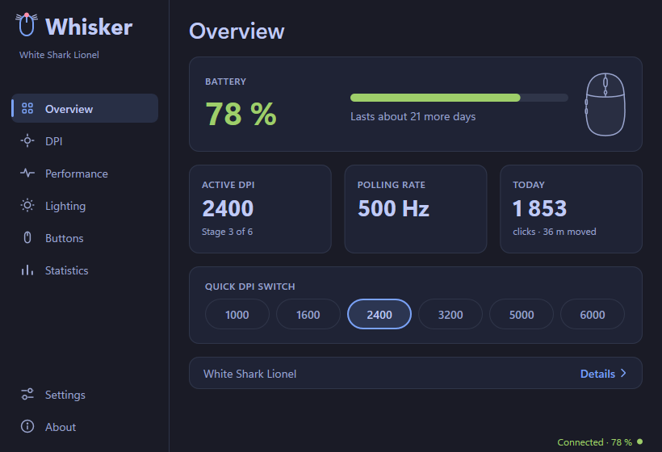
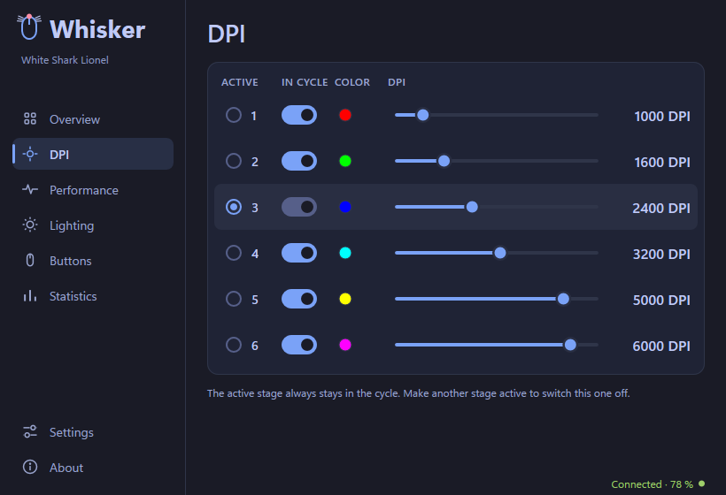
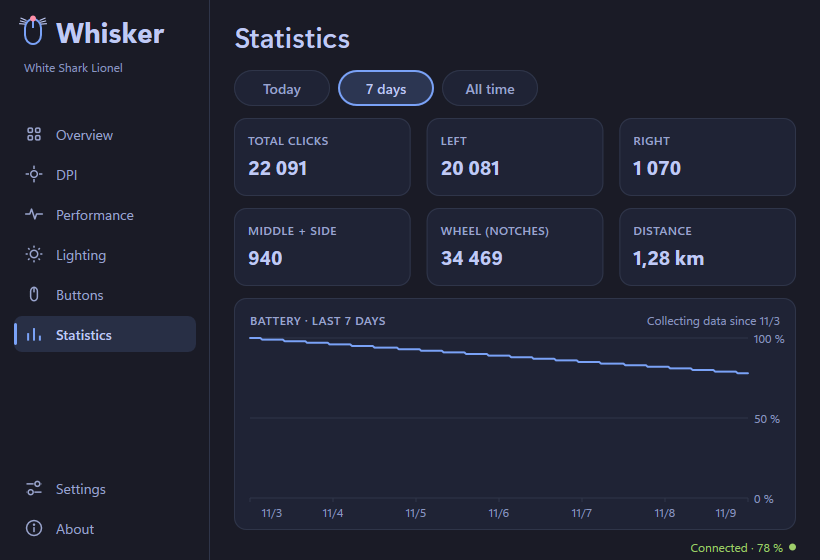

# Whisker

A lightweight control app for gaming mice. One small native program for
Windows, Linux and macOS instead of a heavy vendor suite: set DPI, report
rate, lighting and buttons, watch the battery, and see how much you click.
An open-source alternative to Razer Synapse, Logitech G Hub and similar
mouse software.



## Features

- **Battery** in the window and the tray icon, with a runtime estimate.
- **DPI stages** with colours, a quick switch on the overview.
- **Performance:** report rate, debounce, lift-off distance, sleep timer,
  and a live measurement of the real report rate.
- **Lighting** effects, brightness, speed and direction.
- **Buttons and macros:** remap any button.
- **Statistics** for any mouse: clicks, wheel, distance, battery history.
- 9 colour themes or the system one, 13 languages, no account, no
  telemetry.

What a mouse offers depends on its driver; screens it does not support
are hidden.

| DPI stages | Statistics |
|---|---|
|  |  |

## Supported mice

| Level | Meaning | Mice |
|---|---|---|
| Supported | Tested on the mouse | White Shark Lionel, Logitech M705 |
| Partial | Some functions, tested | Eternico AET-MS480B (battery, DPI stage) |
| Experimental | Written from protocol documentation, not yet tested on the mouse | 180+ models: Logitech (HID++ 2.0), Razer, SteelSeries, Corsair, ASUS ROG, Roccat, Glorious, ATK, VXE / VGN / Lamzu |
| Statistics only | Any other mouse | clicks, wheel and distance; battery over Bluetooth where available |

The full list is in [data/mice.toml](data/mice.toml). If you own an
experimental mouse, please tell us whether it works: **About → Help add
your mouse** reads the mouse, runs a few guided checks and opens a
prefilled GitHub issue.

## Install

Download the file for your system from
[Releases](https://github.com/Emlynix/whisker/releases) or
[whisker.emlynix.com](https://whisker.emlynix.com).

**Windows 10 / 11** – `whisker-windows-x86_64.exe`. Run it; no installer is
needed. *Settings → General → Install* copies it to your user programs and
adds a Start menu entry and optional start at sign-in.

**Linux (x86-64)** – `whisker-linux-x86_64`. Needs GTK 3; the tray icon
needs `libayatana-appindicator3` (or `libappindicator3`).

```sh
chmod +x whisker-linux-x86_64 && ./whisker-linux-x86_64
```

Talking to a mouse needs access to its `hidraw` device. Whisker shows the
exact command when access is missing; it installs
[bundle/linux/70-whisker.rules](bundle/linux/70-whisker.rules), which gives
the logged-in user access to mice of the supported brands only.

**macOS** – `whisker-macos-universal.zip`. Not yet signed: open it the first
time with right click → Open.

## Privacy

Whisker works offline. Its only network connection is a daily update check
(on by default, off in *Settings → General*): an HTTPS request to
`whisker.emlynix.com`, or GitHub as a fallback, that sends your IP address
and the app version. Updates are verified against a SHA-256 hash and an
ECDSA signature before they replace the app. Settings and statistics stay
on your computer.

## Build from source

Rust 1.85 or newer (edition 2024).

```sh
cargo build --release
```

- **Linux:** install the GTK 3 development package first
  (`libgtk-3-dev` on Debian / Ubuntu, `gtk3-devel` on Fedora).
- **macOS:** `cargo build --release --target aarch64-apple-darwin`, then
  `bundle/macos/make-app.sh aarch64-apple-darwin` builds `Whisker.app`.

Run the tests with `cargo test`.

## Contributing

Bug reports, mouse reports and pull requests are welcome; see
[CONTRIBUTING.md](CONTRIBUTING.md). Code contributions need a signed
[Contributor License Agreement](CLA.md).

## Acknowledgements

Protocol facts come from the documentation and sources of
[OpenRazer](https://github.com/openrazer/openrazer),
[Solaar](https://github.com/pwr-Solaar/Solaar),
[libratbag](https://github.com/libratbag/libratbag),
[rivalcfg](https://github.com/flozz/rivalcfg),
[ckb-next](https://github.com/ckb-next/ckb-next),
[OpenRGB](https://gitlab.com/CalcProgrammer1/OpenRGB) and
[G-Helper](https://github.com/seerge/g-helper). Whisker's code is written
from scratch. Brand names belong to their owners; Whisker is not affiliated
with any mouse maker.

## License

Copyright © 2026 Emlynix s.r.o.

Whisker is free software: you can redistribute it and/or modify it under the
terms of the [GNU General Public License](LICENSE), version 3 or (at your
option) any later version. It comes without any warranty.
