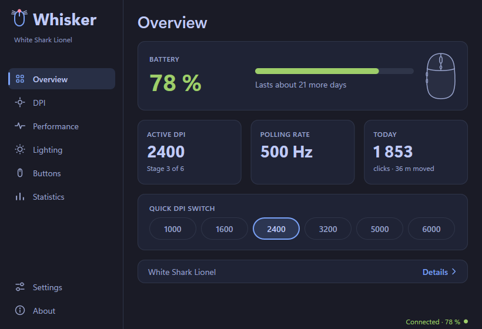
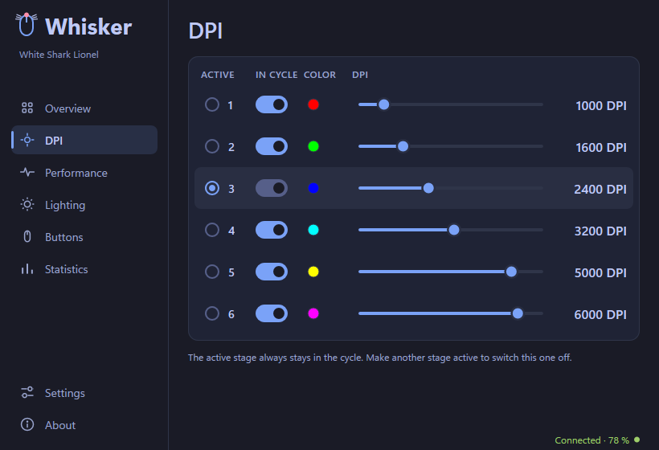
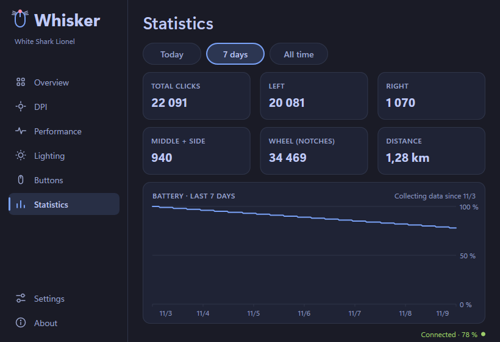

The first public release of **Whisker**, a lightweight control app for
gaming mice. One small native program instead of a heavy vendor suite:
under 1 MB on Windows, no account, no telemetry.

## What it does

- **Battery** in the window and the tray, with a runtime estimate.
- **DPI stages** with colours and a quick switch.
- **Report rate, debounce, lift-off distance, sleep timer**, plus a live
  measurement of the real report rate.
- **Lighting** effects, brightness, speed and direction.
- **Button remapping and macros.**
- **Statistics** for any mouse: clicks, wheel, distance, battery history.
- 9 colour themes or the system one, 13 languages.
- Daily update check (can be turned off); updates are signed and
  verified before they install.

| DPI stages | Statistics |
|---|---|
|  |  |

## Mice

- **Supported (tested):** White Shark Lionel, Logitech M705.
- **Partial:** Eternico AET-MS480B.
- **Experimental**, written from protocol documentation and waiting for
  testers: 180+ models from Logitech, Razer, SteelSeries, Corsair,
  ASUS ROG, Roccat, Glorious, ATK, VXE, VGN and Lamzu.
- **Any other mouse:** statistics.

Own an experimental mouse? **About → Help add your mouse** sends us a
report in a minute.

## Download

| System | File |
|---|---|
| Windows 10 / 11 (x86-64) | `whisker-windows-x86_64.exe`: run it, no installer needed |
| Linux (x86-64, GTK 3), experimental | `whisker-linux-x86_64`: `chmod +x`, run; the app shows how to grant mouse access |

Every file has a `.sig` signature made with the Whisker release key.
macOS will follow in a later release.

Licensed under GPL-3.0-or-later. © 2026 Emlynix s.r.o.
